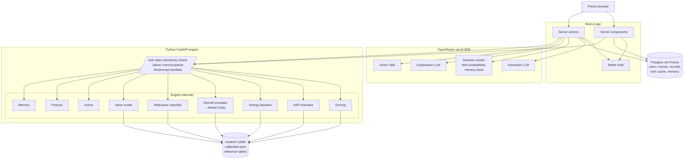
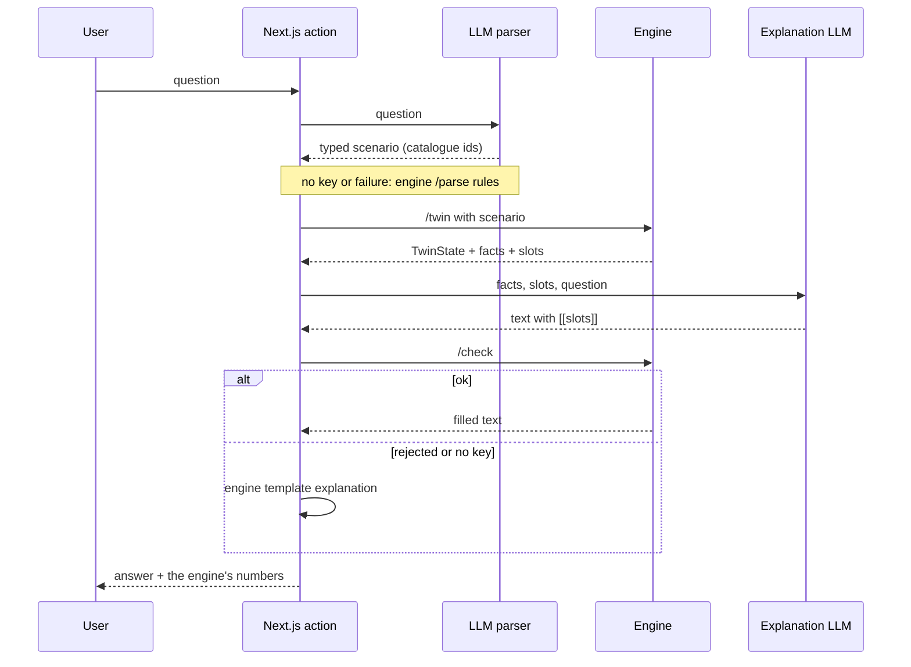
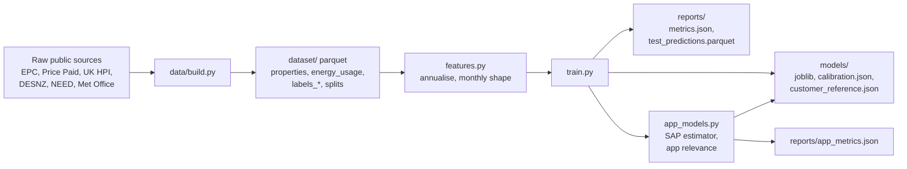

# Architecture

Deliverable F. The system has three parts: a mobile-first Next.js app, a Python FastAPI engine, and an offline training pipeline that produces the engine's model files. For detail on the engine see [model/model_implementation.md](model/model_implementation.md); for the app see [web/README.md](web/README.md).

## 1. Full system

Notes on the diagram:

- The LLM calls run in the Next.js server functions. The Python engine calls no LLM (`api.py`: "No LLM is called here"); it supplies the explanation prompt (`/llm/prompt`) and checks the text the app generated (`/check`).
- The Postgres tables hold users and sessions (Better Auth), homes with their confirmed record, the cached engine result (`twin`, `twinKey`) and customer memory (`Home.memory`), plus extractions, scenarios, chat messages, uploads metadata and the postcode and building caches (`web/prisma/schema.prisma`).
- Every LLM job has a deterministic fallback, so the app works without an API key (table in "LLMs and decision models" in web/README.md).
- Without `ENGINE_URL` the app shows clearly labelled example data (`web/src/lib/twin/mock.ts`).

### Engine endpoints (`model/api.py`)

| Endpoint | Purpose |
|---|---|
| `GET /health` | Model version (part of the twin cache key) |
| `POST /twin` | The `TwinState` for a record and place, optionally for a scenario and memory |
| `POST /plan` | Next-band plan (solver) with memory constraints |
| `POST /sensitivity` | How far the score, plan and bill saving move under each plausible answer to a review question |
| `POST /parse` | Rule-based what-if parser (fallback for the LLM parser) |
| `POST /memory/parse` | Rule-based memory facts (fallback for the decision model) |
| `GET /llm/prompt` | The explanation system prompt and measure labels |
| `POST /check` | Fills `[[slots]]` from the facts and runs the number and claim checks |
| `GET /portfolio` | Poorly performing dataset homes, ranked (precomputed by `greenhome.service_portfolio`) |

## 2. The what-if loop

The measure ids in the typed scenario are validated against the nine-measure catalogue, so a measure outside it cannot be invented. The explanation model never writes a digit: it writes slot names such as `[[package.net_saving_kwh]]`, the engine fills them, and the guardrail rejects unsupported numbers, over-claims, unknown measures, contradicting directions and similar (model_implementation.md section 13.4).

## 3. Offline training pipeline

| Stage | Command | Output |
|---|---|---|
| Dataset build | `cd data && uv run python build.py` then `uv run python validate.py` | `data/out/` (copy to `model/dataset/`) |
| Train and evaluate | `cd model && uv run python -m greenhome.train` | `models/*.joblib`, `models/calibration.json`, `models/customer_reference.json`, `reports/metrics.json`, `reports/test_predictions.parquet` |
| App models only | `uv run python -m greenhome.app_models` | SAP estimator, app relevance model, `reports/app_metrics.json` |
| Everything | `uv run python -m greenhome.run_all` | Train, benchmark, tests, explanation-layer evaluation |

Splits come from `dataset/splits.parquet` (grouped by postcode); calibration is fitted on train homes only.

## 4. The core rule and where it is enforced

Models and formulas calculate; the language model only explains.

| Where | How |
|---|---|
| Score | A documented weighted formula in `model/greenhome/scoring.py`, not a learned model |
| Savings, carbon, bills, SAP, value, finance | Engine calculations and small statistical models (`retrofits.py`, `models.py`, `finance.py`) |
| UI | `web/AGENTS.md` and `web/README.md`: the UI never calculates a score, saving, carbon or value figure; the 3D thermal colours come from the engine's `heatLoss` shares |
| What-if | The scenario is typed, the engine re-runs, and only then is anything explained |
| Explanation | `[[slots]]` only; `/check` fills them and rejects unsupported numbers and claims; template fallback |
| Extraction | The LLM proposes record fields; quotes must appear in the text and the user confirms every field |
| Mock data | `web/src/lib/twin/mock.ts` is a clearly labelled fallback |

## 5. Data flow of a new home

1. **Capture** (`/new`): free-form text, voice, photos, a floor plan, an optional postcode and map selection, bills or meter CSV. No postcode or form is forced first.
2. **Extraction:** an LLM reads the description into the record's own answer options (keyword rules without a key). The decision model gives a probability for every option of every choice field.
3. **Review:** `/sensitivity` re-runs the home under each plausible answer and measures how far the score, plan and bill saving move. The review asks high-stakes, uncertain questions first, pre-fills only confident answers (at or above `DECISION_CONFIDENT`) for a one-tap confirm, and groups the rest as quick confirms. Every applicable required field and usage must be filled before finishing.
4. **Confirm:** the confirmed record is saved on the home.
5. **Engine:** `/twin` returns the `TwinState`. The result is saved on the home with a key built from the record, its place and the engine's model version, so pages read it instantly and an edit or a retrain recomputes it (`web/src/lib/engine.ts`).
6. **Twin and Ask:** the 3D twin renders from the record's geometry and the engine's `heatLoss` shares; what-ifs follow the loop above.

## 6. Trust boundaries

Each statement below is taken from web/README.md or the code.

| Boundary | What holds |
|---|---|
| Sessions | Server functions and API routes re-check the session; `src/proxy.ts` only redirects on cookie presence. Another user's home id is a 404 |
| Uploads | Photos and plans are served only to their owner (`web/src/app/api/uploads/[id]`: session check, then the input must belong to a home of that user) |
| Bills | Sent to the vision model in memory; nothing is stored. The model only transcribes printed periods and consumption; arithmetic and plausibility checks in `lib/extract/bill-checks.ts` decide what is accepted, and the user confirms before anything is used |
| Postcodes | Looked up in our own Postgres table (ONS Postcode Directory); lookups never leave our database |
| Engine input | The engine receives the confirmed record and a coarse place (postcode, coordinates, region, country, district) from `placeOf` in `web/src/lib/engine.ts`. The free-text address is a column on `Home` that is never looked up from EPC |
| Explanation LLM | Receives the engine's facts, the slot values and the user's question (`web/src/lib/llm/explainer.ts`); its output is untrusted until `/check` passes |
| EPC data | Used only to train the model; never shown in the app |
| Engine | The Python engine calls no LLM (`model/api.py` docstring) |

Open question left out of this table: what the extraction LLM receives beyond the typed description is not documented in web/README.md, so it is not claimed here.

## 7. Performance notes

Documented in the repo:

- `GreenEngine(lite=True)` loads the models only (about 0.2 GB, under a second) for customer-entered homes, reading `models/customer_reference.json` instead of the 129k-home table.
- The engine result is cached on the home against the record, place and model version.
- The engine's model version is cached for 60 seconds in the web app; explanation prompt is fetched once per process.
- 3D: on-demand frame loop, no shadow maps, one material per house part, DPR capped at 1.75 and dropped to 1 if the frame rate falls, rendering pauses off-screen, with a static fallback when WebGL is unavailable (web/README.md "3D performance rules").
- Training's per-home evaluation runs on `GREENHOME_WORKERS` processes; results are identical for any value.
- No latency or LLM-cost figures are recorded in the repo docs, so none are stated here.
