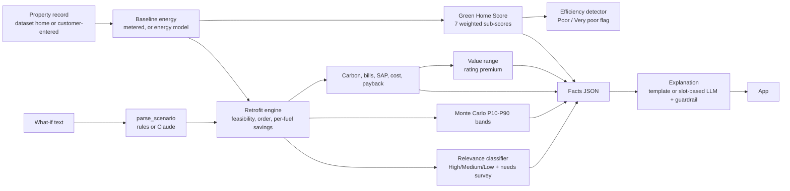

# Model implementation: Green Home Score and Retrofit Recommendation Engine

This document describes exactly what the system in `model/` does, how, and why. It covers every execution path, every rule and constant, every decision we made (with the reason), and the edge cases. Numbers quoted here are from the build in `reports/metrics.json` at the time of writing; the code is the source of truth.

**Contents**
1. [What the system is, and the one rule that shapes it](#1-what-the-system-is-and-the-one-rule-that-shapes-it)
2. [Architecture and module map](#2-architecture-and-module-map)
3. [Data the model reads](#3-data-the-model-reads)
4. [Feature construction: annualisation and monthly shape](#4-feature-construction-annualisation-and-monthly-shape)
5. [Entry points and execution paths](#5-entry-points-and-execution-paths)
6. [Green Home Score](#6-green-home-score)
7. [Energy baseline and the fallback model](#7-energy-baseline-and-the-fallback-model)
8. [Retrofit engine](#8-retrofit-engine)
9. [Carbon, bills, SAP and property value](#9-carbon-bills-sap-and-property-value)
10. [Uncertainty: Monte Carlo bands and calibration](#10-uncertainty-monte-carlo-bands-and-calibration)
11. [Machine-learning components](#11-machine-learning-components)
12. [Efficiency detector and portfolio ranking](#12-efficiency-detector-and-portfolio-ranking)
13. [Language-model layer: explanations and what-if parsing](#13-language-model-layer-explanations-and-what-if-parsing)
14. [Next-band solver](#14-next-band-solver)
15. [Customer memory](#15-customer-memory)
16. [Conflict flags and the Break-it suite](#16-conflict-flags-and-the-break-it-suite)
17. [Customer-entered homes](#17-customer-entered-homes)
18. [The app](#18-the-app)
19. [Training, splits, calibration and evaluation](#19-training-splits-calibration-and-evaluation)
20. [Edge-case catalogue](#20-edge-case-catalogue)
21. [Decisions and their reasons](#21-decisions-and-their-reasons)
22. [Known limitations and open decisions](#22-known-limitations-and-open-decisions)
23. [Reproducibility, tests and how to run](#23-reproducibility-tests-and-how-to-run)

---

## 1. What the system is, and the one rule that shapes it

For one home the system answers four questions: **how green is it now, what should be improved, how much energy and carbon would that save, and could it add value.**

**Core rule (from the brief): models and formulas calculate, the language model only explains.**
- The Green Home Score is a documented weighted formula, not a learned model.
- Savings, carbon, bills, SAP and the value uplift come from documented calculations and small statistical models.
- Machine learning is used only for (a) estimating usage when there is no meter data, (b) rating how large a measure's saving is with a confidence (the relevance classifier), and (c) the price level used to evaluate the value model.
- The language model (Claude) never writes a number. It refers to named slots that the engine fills (section 13). A what-if request first re-runs the engine; only then is anything explained.

**Everything is an estimate.** Outputs carry ranges where we can quantify them, are labelled as estimates, and never claim causality for value.

---

## 2. Architecture and module map



| File | Responsibility |
|---|---|
| `greenhome/config.py` | Every constant: score weights and sub-score maps, annualisation thresholds, emission factors, tariffs, retrofit parameters, calibration. Fails loudly if a dataset file is missing. |
| `greenhome/features.py` | Annualises monthly usage, builds monthly-shape ("twin") features, builds the cached master table. |
| `greenhome/scoring.py` | The Green Home Score, classification, key issues, provisional bounds. |
| `greenhome/retrofits.py` | Feasibility, needs-information, savings simulation, SAP after, costs, Monte Carlo, recommendations. |
| `greenhome/models.py` | LightGBM models: energy fallback, relevance classifier, value model; HPI price anchor. |
| `greenhome/engine.py` | `GreenEngine`: one pipeline for a home, scenario handling, portfolio ranking. |
| `greenhome/llm.py` | Facts, template explanation, slot rendering, guardrail, what-if parsing (rules and Claude). |
| `greenhome/solver.py` | Cheapest packages to reach the next band. |
| `greenhome/memory.py` | Customer memory that changes the plan. |
| `greenhome/breakit.py` | Conflict flags and the fault-injection suite. |
| `greenhome/custom.py` | Builds a full property record from what a customer can type. |
| `greenhome/train.py` | Trains and evaluates everything, writes `models/` and `reports/`. |
| `greenhome/benchmark.py`, `llm_eval.py`, `whatif_eval.py` | Reporting and evaluation harnesses. |
| `greenhome/run_all.py` | One command: train, benchmark, tests, explanation / what-if / Break-it evaluation. |
| `app.py` | Streamlit app (seven tabs). |
| `tests/` | 39 tests: rules from the brief, property-based monotonicity, reconciliation, solver, memory, Break-it. |
| `greenhome/reference/council_hpi_2026-07.csv` | Public UK HPI average prices by council and type (July 2026), with source URLs. |

---

## 3. Data the model reads

Read-only parquet files in `dataset/` (gitignored; built by `data/build.py`, documented in `dataset/docs.md`). The engine and models never read `hidden/` and never read `labels_*` at inference time.

| Table | Used for | At inference? |
|---|---|---|
| `properties` | One row per home: real EPC fields, typed fabric and heating columns, value estimate, optional `setpoint_reported_c` | Yes |
| `energy_usage` | 24 months x home, simulated, NaN = missing reading | Yes (annualised once into the master table) |
| `monthly_hdd` | Heating degree days by climate region and month | Yes |
| `emissions_factors` | DESNZ 2025: electricity 0.19553, gas 0.18296 kg CO2e/kWh | Yes |
| `retrofit_catalogue` | Applicability rules, impact model, indicative cost low/high, fabric-first order | Yes (costs) |
| `splits` | train / val / test / geo_test (Liverpool) | Training and evaluation only |
| `sales_history` | Real sales, HPI-indexed | Value model training only |
| `labels_retrofit`, `labels_package`, `labels_package_sequence`, `labels_value` | Simulated reference labels | **Training and evaluation only** |
| `epc_recommendations` | Real RdSAP recommendations | Evaluation and calibration only |

**Missing is NaN, never zero.** A zero reading means the home has no such supply. A missing month is a NaN row.

**Coverage in this dataset:** 129,318 homes; usage unavailable for 2,531 (2.0%); solar status unknown for 2.2%; roof insulation unknown for 1,302; monthly-shape features for 98%; heating-temperature report for 30%; 119,479 homes are grid-electricity + gas (the rest are heat network, other fuel or no heating).

---

## 4. Feature construction: annualisation and monthly shape

### 4.1 Annualisation (`features.annualise`)
For each fuel (electricity import, gas, heat network, other fuel):

`annual = sum(observed months) / sum(w_t over observed months)`, with `w_t = (1 - hs)/12 + hs * HDD_share_t`

- `hs` is the share of that fuel's use that follows heating demand: gas 0.75, heat network 0.75, other 0.75, electricity 0.50 for electrically heated homes, 0.05 otherwise. `HDD_share_t` is the month's share of the year's heating degree days for the home's climate region.
- With every month observed the sum of weights is 2, so the result is the two-year mean.
- **Unavailable (NaN)** when fewer than 6 months are observed **or** no December-to-February month is observed. This stops a home with only summer months from looking like a low user.
- `usage_status` is `metered` only when both electricity and gas annual values exist, otherwise `unavailable`.
- Also derived: `intensity` = delivered energy (all fuels) per m2, only for metered homes with floor area between 20 and 500 m2; `purchased_kwh` = grid import + gas (the PS definition used for improvement potential).

### 4.2 Monthly-shape features (`features.twin_features`)
For each home, a least-squares fit of monthly use against heating degree days, separately for gas and electricity:

`use = base + slope * HDD`

Features: slope (how fast heating use rises as it gets colder; reflects true heat loss and the household's thermostat), base (weather-independent load), fit R2, summer and winter means, winter/summer ratio, plus slope per m2 and slope against the EPC heating cost. NaN months are skipped; fewer than 8 observed months gives all-NaN (never a guess). 98% of homes have them.

**Why:** the hidden thermostat setting and the true insulation of "assumed" walls drive the savings of smart controls and wall insulation but are not in the property record. The monthly shape recovers part of that signal. Adding these features raised the relevance classifier's informative macro-F1 from 0.855 to 0.889.

### 4.3 Optional heating-temperature report (`setpoint_reported_c`)
A noisy, partial report of the household's usual heating temperature, simulated for 30% of homes (hidden setpoint + N(0, 0.7 C), rounded to 0.5 C). It is an input only. The model also trains with it masked, and a customer can leave it blank. Any gain from it is a property of the simulator's design, not evidence about real homes.

### 4.4 Master table (`features.build_master`)
Joins properties, splits, annualised usage and twin features, adds `intensity` and `purchased_kwh`, and caches `reports/cache/master.parquet`. `build_master(refresh=True)` rebuilds it; training always refreshes.

---

## 5. Entry points and execution paths

`GreenEngine.analyse_property(p, scenario=None)` is the single pipeline for one home. `GreenEngine.analyse(pid, scenario)` loads a dataset home and calls it.

### 5.1 Path decision tree

| # | Situation | What happens |
|---|---|---|
| A | Dataset home, `usage_status = metered`, `fuel_scope = gas_elec` | Baseline = metered annual electricity and gas. Score uses metered intensity. Full retrofit analysis. |
| B | Dataset home, usage unavailable (about 2% of homes) | Baseline = energy model estimate, flagged `modelled`. **Modelled usage never enters the score**: the intensity component is dropped and the score is provisional. Improvement potential and savings use the modelled baseline. |
| C | `fuel_scope` is `heat_network`, `other_fuel` or `no_heating` | Score is still computed. Every measure is marked "outside grid-electricity + gas accounting"; savings, carbon, improvement potential and value are unavailable, with the reason. |
| D | Customer-entered home with energy readings | Treated as metered (12 months) and flagged `user_entered`. |
| E | Customer-entered home without readings | Lean energy model (no EPC-modelled inputs) gives the baseline, flagged `modelled`. Score is provisional (intensity missing). |
| F | `scenario = None` | The default package is analysed (all feasible measures, fabric-first, heat pump replacing a boiler upgrade). |
| G | `scenario = [measures]` | Measures are put in catalogue order. Measures that are not feasible are reported in `infeasible_requested` and not simulated. Those that are unknown rather than infeasible are flagged `needs_info`. |
| H | No feasible measure selected | Result carries no savings; the app says so (or that the measures cannot be estimated yet). |
| I | Free-text what-if | `llm.parse_scenario` turns it into a measure list (rules, or Claude when a key is set), then path G. |

### 5.2 `analyse_property` step by step
1. `baseline(p)`: metered annual electricity and gas, else the energy model (full model when the home has EPC-modelled fields, lean model otherwise).
2. Score now: `green_score` on the home, with `intensity` only if metered.
3. Data-quality block: usage source and months, partial score flag, savings availability, data flags, **conflict flags** (section 16), whether user-entered, unavailable reason.
4. `needs_information`: measures that cannot be judged because the record does not say.
5. If not gas+electricity: return early (path C).
6. `recommend`: feasible measures, default package, no-heat-pump package, per-measure suitability.
7. Relevance classifier: attaches `ml_relevance` (High / Medium / Low or "needs survey", with confidence) to each recommendation.
8. `analyse_scenario` for the requested or default measures.
9. Score after: applies the scenario's new state to the home (`new_state`), the new SAP and rating, and the reduced intensity (metered homes only), then scores again.
10. Value uplift (if there is a current value estimate and at least one measure).
11. Monte Carlo bands (150 draws) for the selected measures.
12. Return a single payload used by the app and the explanation layer.

---

## 6. Green Home Score

`S = sum_k w_k * s_k`, rounded to an integer, with the seven fixed weights from the brief.

| Component | Weight | Input | Sub-score mapping (all monotone: a better state never scores lower) |
|---|---|---|---|
| Energy efficiency | 25% | Recorded EPC SAP score | The SAP score itself, clipped to 1-100 |
| Energy consumption intensity | 20% | Annualised **metered** delivered kWh/m2/yr | Piecewise-linear on 40/80/120/170/250/350 kWh/m2 giving 100/88/70/50/25/0 |
| Insulation | 15% | Wall level, loft depth or roof category, floor | Weighted mean of the available parts: walls 50%, roof 35%, floor 15% |
| Heating system | 15% | Heating type, boiler condensing flag | heat pump (air or ground) 100; community 75; gas condensing 70; gas boiler unknown 55; electric storage 45; gas non-condensing 40; gas warm air 40; electric direct 35; gas room heaters 30; oil 30; solid fuel 10 |
| Windows and glazing | 10% | Glazing level 0-5 | single 5; partial double 35; mostly double 55; double 75; high performance 92; triple 100 |
| Renewable energy | 10% | Estimated solar kWp | Linear on 0/1/2/3/4 kWp giving 0/35/60/80/100 |
| Smart energy management | 5% | Controls level 0-3 | none 0; basic 20; programmer + thermostat/TRVs 50; zoned/smart 100 |

Insulation parts:
- **Wall level** 0/1/2/3 (none / partial / insulated / filled+) gives 10/45/90/100.
- **Roof:** if a loft depth is stated, linear on 0/50/100/150/200/270 mm giving 0/25/50/70/85/100; otherwise the category (none 5, limited 40, insulated 75); unknown is excluded. A roof that is not applicable (a dwelling above) is excluded, not penalised.
- **Floor:** none 15, limited 55, insulated 100; not applicable or unknown is excluded.

Classes: 80-100 Highly efficient, 65-79 Good, 50-64 Moderate, 30-49 Poor, 0-29 Very poor.

**Components shown to the user:** each component's sub-score, weight and points contribution; key issues (components scoring under 40, ordered by weighted gap, written in plain language).

### 6.1 Missing components (current behaviour)
A component whose input is unknown is **excluded and the remaining weights are renormalised to sum to 1** (`partial = True`). The result is labelled **provisional** and shown with a low-high range: missing inputs as bad as possible (sub-score 0) versus as good as possible (100). Typical cases: no energy readings (intensity missing), solar status unknown (renewables missing). An unknown PV status is **not** treated as "no solar".

> **Open decision.** The PS says the weights are fixed (page 1, and slide 4: "Sigma w_k = 1") and grades "Correct use of the fixed weights" (page 6). Renormalising changes the effective weights per home. A more literal reading keeps all weights fixed and gives a missing component a documented default sub-score (for example the median for similar homes) with a confidence flag. See [section 22](#22-known-limitations-and-open-decisions).

### 6.2 Double counting
No raw input column feeds two sub-scores. SAP (efficiency) is the recorded rating only; intensity is metered usage only. Across the data, the correlation of SAP with metered intensity is -0.35, against -0.74 with the EPC's own modelled intensity, so the intensity component is not just the rating again.

### 6.3 Large homes
Intensity is per m2, so a large home is not marked inefficient merely for using more energy in total.

### 6.4 Score after a retrofit
The scenario's `new_state` is applied to the home: glazing level at least 3 if glazing is installed, controls level 3, wall level 2, loft 270 mm and "insulated", floor "insulated", heat pump as the heating system, boiler condensing at the new efficiency, added solar kWp and `has_solar_pv = True`. SAP and rating come from section 9.3; metered intensity falls by the net kWh saving per m2. The Green Home Score and the EPC rating (SAP) are different metrics: the score can rise a lot while SAP barely moves.

---

## 7. Energy baseline and the fallback model

**Primary:** the metered annual electricity and gas (section 4).

**Fallback** when usage is unavailable (or a customer gave none): LightGBM regressors predicting `log(1 + annual electricity)` and `log(1 + annual gas)` from property features (type, built form, age, area, rooms, wall, roof, floor, heating, climate region, SAP, EPC-modelled energy, CO2 and costs, fabric levels, solar, lighting, location).
- **Full model** is used for dataset homes (EPC fields available).
- **Lean model** drops the EPC-modelled fields (primary energy, CO2, EPC costs) that a customer cannot know, and is used for customer-entered homes.
- Trained on metered train homes only. On the test split gas MAE is 1,121 kWh against 3,450 for the type-by-size median baseline, and electricity MAE 521 against 1,018.
- Output is always flagged `modelled`, and modelled usage **never feeds the score**.

---

## 8. Retrofit engine

Nine measures in a fixed **fabric-first order**: loft insulation, cavity wall insulation, solid wall insulation, floor insulation, double glazing, smart controls, heat pump, condensing boiler, solar PV (2.5 kWp).

### 8.1 Feasibility (hard rules, never a model)
`feasibility(p)` returns `(feasible, reason)` for every measure. Homes outside grid electricity + gas get `False` for all measures.

| Measure | Feasible when | Otherwise (reason) |
|---|---|---|
| Loft insulation | Pitched or roof-room roof **and** loft saving > 0 (depth under 200 mm, or roof category none/limited) | "Not a pitched roof" / "Loft already adequately insulated" |
| Cavity wall | Cavity wall with wall level 0 or 1 | "No uninsulated cavity wall" |
| Solid wall | Solid brick, stone or system-built wall with level 0 or 1 | "No uninsulated solid wall" |
| Floor insulation | Solid or suspended floor with insulation "none" | "No uninsulated ground floor" |
| Double glazing | Glazing level known and 2 or less | "Already double glazed or better" |
| Smart controls | Controls level known and under 3, and a gas, electric or heat-pump system | "Zoned/smart controls already present" |
| Heat pump | House or bungalow with gas or electric heating | "Heat pump already installed" / "Flat/maisonette: limited outdoor space" |
| Condensing boiler | Gas boiler recorded as non-condensing | "Boiler already condensing / not a gas boiler" |
| Solar PV | House or bungalow, pitched or flat roof (not a roof room), no existing PV (`has_solar_pv` is False) | "Solar already installed" / "Flat/maisonette or unsuitable roof" |

### 8.2 Unknown is not "fine" and not "impossible" (`needs_info`)
If the record does not say, the measure is **not** judged. It is reported as "Status unknown: ... confirm it before savings can be estimated", never as "already insulated" or "not possible". Unknown cases: loft depth and roof category both unknown on a pitched roof; floor insulation unknown on a solid or suspended floor; cavity or solid wall level unknown; glazing unknown; controls unknown on a heated home; boiler condensing flag unknown on a gas boiler; PV status unknown on a house. In the app a what-if that selects only such measures shows "cannot be estimated yet" rather than an infeasible warning.

### 8.3 Baseline split (`_initial`)
- **Gas-heated** (gas boiler, warm air, room heaters): cooking = 5% of gas; usable gas = gas - cooking; the share going to hot water is taken from the EPC heating and hot-water costs when hot water is also gas; space-heating useful demand `D = usable heating gas x boiler efficiency` (condensing 0.85, non-condensing 0.72, unknown 0.80, other gas 0.72).
- **Electric heating:** `D = electricity x 0.55`.
- **Existing heat pump:** `D = electricity x 0.45 x SCOP`.

### 8.4 Simulation (`simulate`)
Measures are applied in order, each to the state left by the previous one, so **per-measure savings are marginal and add up to the package** (interactions are accounted for, not double counted).

- **Fabric and controls** cut the space-heating demand `D` by a fraction and reduce fuel use through the current system's efficiency: loft 15% / 8% / 3% (0 mm / under 100 mm / 100-199 mm); cavity 12% (none) / 6% (partial); solid wall 22% / 10%; floor 6% (suspended) / 4% (solid); glazing 10% / 7% / 4% (single / partial / mostly double); smart controls 6%.
- **Heat pump** (gas home): removes the gas for space heating and hot water, and adds electricity of `D / SCOP` for heating plus `hot-water heat / DHW SCOP` for hot water (SCOP 2.8, DHW 2.5). (Electric-heated home: electricity changes by `D / SCOP - D`, a net fall.) Because it comes after the fabric measures, a better-insulated home gets a smaller heat-pump electricity load.
- **Condensing boiler:** raises efficiency to 0.85 on the remaining gas. Skipped (with a note) if a heat pump is also selected.
- **Solar PV:** generation = 2.5 kWp x regional yield (850-1000 kWh/kWp) x 45% self-use, limited to current grid import (exports are excluded from purchased energy). It reduces electricity import only.

### 8.5 Sign convention
**Saving = baseline - after, in kWh/year, per fuel. Positive means less use; negative means use rises** (a heat pump shows electricity as a negative saving). The app words this as "saves X kWh" or "uses X kWh more".

### 8.6 Packages
- **Default package:** all feasible measures; a heat pump replaces a boiler upgrade.
- **Fabric-led package:** the same without the heat pump. Always computed and shown beside the full package, because the heat pump dominates improvement potential (counting kWh from both fuels equally, a heat pump cuts purchased energy by roughly 50-60%, far above the brief's illustrative 15-25%).

### 8.7 Costs, payback, suitability
Cost ranges are the catalogue's indicative low/high (median of real EPC indicative costs); the mid-point is used for payback. `payback = mid cost / annual bill saving` (indicative tariffs: electricity 27 p/kWh, gas 7 p/kWh). If the bill saving is 1 pound or less, payback is infinite. **Suitability: High if payback is 10 years or less, Medium up to 20, otherwise Low.**

### 8.8 Heat-pump readiness
After the planned fabric measures, the insulation sub-score is recomputed. If it is under 50, the heat pump's suitability is lowered one tier (High to Medium, Medium to Low) and the reason says to insulate first. If the heat pump raises electricity, the reason says so ("electricity use rises X while gas falls Y"); if bills do not fall, "running costs do not fall at current tariffs". A heat pump is never hidden because its payback is poor: the app shows its carbon benefit and its running-cost change.

---

## 9. Carbon, bills, SAP and property value

### 9.1 Carbon
`Delta C = Delta E_elec x EF_elec + Delta E_gas x EF_gas` (kg CO2e/year; positive = reduction), per fuel, from the DESNZ 2025 factors in the dataset (electricity 0.19553 including transmission and distribution, gas 0.18296, gross CV). A heat pump reduces gas carbon and adds electricity carbon; the net is shown.

### 9.2 Bills
`bills = Delta E_elec x 0.27 + Delta E_gas x 0.07` GBP/year, indicative rates of the order of the Ofgem price cap (not looked up per region or quarter). Used only for payback and suitability and the SAP cost proxy, never for energy or carbon.

### 9.3 SAP after a retrofit (a simplified estimate)
From the SAP cost relation: `SAP = 100 - 13.95 ECF` (ECF under 3.5, else `117 - 121 log10 ECF`). ECF is proportional to running cost, so the energy-cost-factor ratio is applied to the home's real recorded SAP using the change in regulated (heating + hot water) cost, scaled to the EPC's own modelled costs. The gain is multiplied by a scale factor (0.763) fitted on train homes so the average engine gain matches the EPC's own potential-SAP gain. **The SAP never falls below the current SAP**, so a package whose heat pump raises running costs can show no SAP gain while the Green Home Score rises. This is least validated for heat-pump packages (the real EPC recommends them in under 1% of cases). The rating after is the SAP band.

### 9.4 Property value impact
- `uplift = exp(beta x (SAP_after - SAP_before)) - 1` for the same home, everything else held fixed, where `beta` is the rating premium estimated from real sales (section 11.3).
- The range is the 2.5th to 97.5th percentile over a pooled bootstrap of four model specifications, floored at zero, applied to the **current value estimate** (never to a historical sale price).
- Unavailable (shown as "n/a" with the reason) when there is no current value estimate or no measure is selected.
- Always worded as an **indicative, associational range** from historical sales relationships, not a causal increase.

---

## 10. Uncertainty: Monte Carlo bands and calibration

`monte_carlo` re-runs the simulation with parameters drawn from documented ranges and reports P10 / P50 / P90 for per-fuel savings, improvement potential and carbon, for the package and each measure. Ranges: fabric and glazing impacts x U(0.8, 1.2); smart controls x U(0.6, 1.5); SCOP U(2.4, 3.2), DHW SCOP U(2.1, 2.9); condensing boiler 0.80-0.90, non-condensing 0.65-0.78, unknown 0.72-0.88, new boiler 0.82-0.90, other gas 0.65-0.78; solar yield x U(0.9, 1.1), self-use U(0.30, 0.55); cooking share U(0.02, 0.10); electric heating share U(0.45, 0.65); heat-pump home heating share U(0.35, 0.55).

**Calibration** (`train.calibrate`, fitted on **train** homes only, saved to `models/calibration.json`):
1. The SAP gain scale so the engine's mean SAP gain for the EPC-recommended measures matches the EPC's own potential-SAP gain (0.763).
2. Widening factors for the band half-widths so P10-P90 covers about 80% of reference savings (electricity 1.0, gas 2.0, improvement 1.75, carbon 1.75).

The bands reflect **parameter uncertainty only**. They do not include behaviour, tariff changes or model-structure error beyond the fitted widening. Held-out coverage: 80-87% (target 80%).

---

## 11. Machine-learning components

All LightGBM, fixed seed 42, deterministic mode, fitted on the **train** split only. The score and the savings are not learned.

### 11.1 Energy fallback model (section 7)
Two regressors per variant (full, lean), 400 trees, learning rate 0.05, 31 leaves.

### 11.2 Retrofit relevance classifier (`RelevanceModel`)
**What it predicts:** for one home and one feasible measure, whether the saving will be **High** (about 10% or more of purchased energy), **Medium** (3% to 10%) or **Low**. It tells the customer which measures matter most for their home and says "needs survey" when unsure.

**Labels:** a threshold rule on the dataset's simulated per-measure saving. So this measures how well the model re-learns that rule from visible features, not agreement with real assessors.

**Features:**
- Property features (type, built form, age, area, rooms, wall, roof, floor, heating, climate region, SAP, EPC-modelled energy and costs, fabric levels, solar, lighting, location) and the measure id.
- Metered-usage features: annual electricity and gas, intensity, purchased energy, gas and electricity per m2, metered use against EPC-implied use, gas against EPC heating cost, electricity share.
- Monthly-shape features (section 4.2).
- Optional heating-temperature report (section 4.3).

**Robustness:** during training, independently, 15% of rows have the usage block masked, 15% the EPC-modelled block, 15% the monthly-shape block (which is also masked whenever the usage block is, since a home with no readings has no monthly shape) and 15% the heating-temperature block. So the model still works for homes with no meter data, no EPC numbers, annual totals only, or no heating temperature. Missing values stay NaN.

**Calibration and abstention:** probabilities are temperature-scaled on validation (T = 0.90). The abstention threshold is set on validation so about 80% of predictions pass (confidence 0.865). Predictions below it are returned as **"needs survey"** with the model's best class kept alongside.

**Parameters:** 250 trees, learning rate 0.08, 63 leaves, 30 minimum child samples, 0.8 row and column subsampling.

**Honest reading of the numbers:** heat pump, solar and boiler are almost always one class, so headline figures use the other six measures. Smart controls and the wall measures are the hardest because their savings depend on hidden thermostat setting and on whether "assumed" walls are really insulated. Results are in section 19.

### 11.3 Value model (`ValueModel`)
- **Price level:** LightGBM predicting `log(price / council HPI average for the type)` from size, type, built form, age, location relative to the council centre (not absolute coordinates), distance from the centre and the log HPI level. Predicted price = HPI reference x exp(model). Anchoring on a public, council-level price lets it carry over to a city it never saw; before this, Liverpool's median error was 47.9%, now 29.6%.
- **Rating premium:** stage two regresses the log-price residual on SAP. The range pools four specifications (ML-partialled, outcode fixed effects with type, area and age, minimal controls, and a council-level cluster bootstrap). The premium varies a lot between cities in the data (about -4% to +7.5% per 10 SAP points), so the range is not reliable for a new area.
- **Use in the product:** only the relative premium is used. The baseline value is the dataset's `current_value_estimate`.

### 11.4 EPC-recommendation classifier (evaluation only)
A LightGBM trained to predict whether the real RdSAP software recommends each measure. It is not used in the product; it is independent evidence that our features capture the real software's logic (AUC 0.88-0.99 on informative measures).

---

## 12. Efficiency detector and portfolio ranking

- **Poor-home flag:** a home is flagged when its class is Poor or Very poor, with its key issues.
- **Ranking:** poor homes are ranked by improvement potential, `100 x (E_baseline - E_after) / E_baseline`, where E is grid electricity imported plus gas, with the same accounting before and after. Both the full package and the fabric-led package are ranked.
- **Unavailable** (NaN with a reason) for homes outside grid + gas accounting and for zero baseline energy.
- **Fairness to large homes:** flagging uses intensity (kWh per m2), not total use.
- Cached in `reports/cache/portfolio.parquet`; `engine.portfolio(refresh=True)` rebuilds.

---

## 13. Language-model layer: explanations and what-if parsing

### 13.1 Facts
`llm.facts(analysis)` flattens the engine payload into pre-rounded facts: property, data quality (including conflicts), score and class, components, key issues, per-measure and package savings per fuel, carbon, bills, cost, rating and score after, P10-P90 ranges, value range, excluded and infeasible measures, notes. This is everything the language model may state.

### 13.2 Template explanation (always available)
`template_explanation` writes a deterministic explanation from the facts: score and class and issues; a data-quality line (no readings provided versus too few months); conflict warnings ("Please check your inputs"); unavailable-savings reason; infeasible or "cannot be estimated yet" measures; the scenario with per-fuel changes, carbon, rating and score; the likely range; the value range or why it is unavailable; and "All figures are estimates, not guarantees."

### 13.3 Slot-based Claude explanation (`generate`, `explain`)
- The prompt gives the facts and a list of **slots** (for example `package.net_saving_kwh`). The model must **never type a digit**; to mention a number it writes the slot name in double brackets, and the engine inserts the value (`|abs` gives the size of a negative number).
- Rules in the system prompt: use only facts; report electricity and gas separately; call everything an estimate; say a requested measure is infeasible rather than quoting savings; say what is missing instead of guessing; be concise.

### 13.4 Guardrail
After rendering, the text is rejected if any of these hold:
- an unknown slot, a digit typed outside a slot, a slot not followed by its unit, or a pound slot not preceded by a pound sign;
- a number not present in the facts at the precision written (units must match: kWh, %, pounds, tonnes, kg);
- an over-claim ("guarantee", "will save", "definitely", "proven", "risk-free");
- a measure not in the catalogue (battery, draught proofing, LED lighting, triple glazing, ground-source and so on);
- savings claimed for an infeasible or excluded measure;
- a direction of fuel change that contradicts the engine (electricity or gas up versus down);
- a class name that is not the home's current or after class;
- a value impact stated when none was computed.

**Fallback:** a rejected answer, a missing key, or a network or authentication error all return the template explanation with a plain note (the exception type is not shown to the customer).

**Known limit:** an invented non-numeric statement about the home (for example "your roof is damp") that mentions no number, measure or class is almost never caught (about 1% in the red-team test), and 86% of wrong class names are caught. **The real language model has not been evaluated** (no API key was available); only the template and the guardrail were.

### 13.5 What-if parsing (`parse_scenario`)
Free text becomes a typed scenario `{retrofits, source, unsupported, note}`; ids are always validated against the catalogue, so a measure outside it can never be invented.

**Rules (default):**
- Measures are found by keyword: loft/roof insulation/attic; cavity; solid/external/internal wall; floor insulation/underfloor/the floor; glazing/window; thermostat/smart/heating control; heat pump/ashp; condensing/new boiler/boiler; solar/panel/pv.
- Generic words expand: "insulation" gives loft + both wall types + floor; "wall" gives cavity + solid (the infeasible one is reported by the engine).
- Text is split into **negated** parts (after without, skip, except, excluding, exclude, apart from, but not, do not want, rather not, rather avoid, avoid, leave out, instead of, not, no) and **positive** parts; a negation ends at "but", "plus", "also", a sentence end, or a comma before just, only, then, do. "Everything but X" and "all bar X" are rewritten as "everything except X".
- "Everything", "all", "the full package", "every measure", "the lot" select all measures except the condensing boiler (unless named), then negated measures are removed last. Only negations ("without solar") start from the current selection.
- A heat pump discards the boiler unless a boiler was asked for.
- Requests for things outside the catalogue are reported in `unsupported` and explained; a request that names no measure keeps the current selection with an explicit note.

**Claude parser (optional):** with `ANTHROPIC_API_KEY`, Claude returns JSON `{start_from, include, exclude, unsupported}`; ids are validated, and responses are cached by input hash (so a rerun without a key reproduces them). Invalid or unavailable output falls back to the rules.

**Measured:** the rule parser scores 56/56 and 15/15 on the two sets it was developed with, and **12/15 (0.80) on a fresh held-out set** written before the last round of changes. Its misses are phrasings like "skip everything except solar", "insulating the roof" (no keyword) and "leave the heat pump out". The Claude parser has not been scored.

---

## 14. Next-band solver

`solver.plan(engine, home, target_score=None, exclude=(), budget_gbp=None, top=3)` finds the cheapest packages that lift the Green Home Score to the next class (or a given score).

1. Unavailable for homes outside grid + gas accounting.
2. Candidates = feasible measures not excluded. **Every non-empty combination is evaluated** (at most 511 for nine measures; no heuristic), except that a heat pump and a boiler upgrade are never combined.
3. Each combination is simulated by the same engine; the score after uses the same rules as section 6.4.
4. Qualifying packages reach the target (and fit the budget, using the mid-point cost). They are sorted by cost, then by carbon; only **minimal** sets are kept (no cheaper subset already reaches the target); the cheapest `top` are returned.
5. A cost-versus-score **frontier** (best score for each budget) is returned for charting.
6. **If nothing reaches the target** it says so and reports the best reachable score and the measures that achieve it. If the home is already in the top band it says that.
Costs are catalogue ranges; bills use indicative tariffs; everything is labelled an estimate.

---

## 15. Customer memory

Memory changes **what** is recommended; every number still comes from the engine. Stored per customer: completed measures, declined measures with a reason, constraints (renting, listed building or conservation area, budget) and a stated priority. It is held for the session in the app; the module can also save a small JSON file under an opaque id.

**Parsing (rules):** notes are split into clauses; a clause naming measures is *declined* if it carries a refusal phrase (reason captured: too disruptive, too expensive, landlord, and so on), else *completed* if it carries a completion phrase (installed, fitted, had, already have). "Rent/tenant/landlord", "listed/conservation area", a budget ("budget up to 5,000", "3k") and a priority (carbon, bills) are recognised.

**Effects (`personalise`):**
- **Completed work** is applied to the home model: the new state, SAP, rating, baseline energy and score all update, and the measure is excluded as "already done". The baseline becomes a model estimate updated from the customer's report, not a meter reading. If the starting condition was unknown, the work is **recorded as done** and the state updated, but the energy baseline is not adjusted (the saving cannot be estimated).
- **Declined** measures are excluded, with the reason.
- **Renting:** only controls can be changed by a tenant; every other measure is marked "needs landlord consent".
- **Listed building or conservation area:** window replacement and solid-wall insulation are marked "needs consent".
- **Budget** is passed to the solver. A carbon priority orders the solver's options by carbon cut.
- If constraints leave nothing that reaches the target, the plan says so with the best reachable score.

---

## 16. Conflict flags and the Break-it suite

### 16.1 Conflict flags (`breakit.conflict_flags`)
Shown to the user as "check your inputs"; they never change a number.
- Floor area outside 20-500 m2.
- A room count implausible for the area (area per room outside 6-60 m2).
- Metered intensity more than **2.0x** or less than **0.30x** the EPC-implied intensity (in the training homes 99% lie between 0.35x and 1.5x).
- Gas use above 500 kWh with no mains gas recorded.
- Gas use above 3,000 kWh with electric or heat-pump heating recorded.
Clean homes are wrongly flagged 0.6% of the time.

### 16.2 Break-it suite
Ten fault types are injected into real homes and checked against an explicit expectation (5 homes x 10 faults = 50 cases; 50/50 handled as expected): no readings, only 3 months of readings, EPC rating A with 4x typical use, rating F with tiny use, gas use with no gas supply, 3 m2 floor area, community heating, a flat asking for a heat pump, no value estimate, zero baseline. The faults and expectations were written by us, so this shows safe handling of known cases, not general robustness.

---

## 17. Customer-entered homes

`custom.build_property` turns what a customer can type into a full record. Anything unknown stays NaN or None, never zero; fields a customer cannot know (EPC primary energy, EPC costs) are filled from dataset medians for similar homes.

| Input | Mapping |
|---|---|
| Rating A-G | SAP set to the band mid-point (A 96, B 86, C 74.5, D 61.5, E 46.5, F 29.5, G 10) because the customer gives a band, not a score |
| Age band | Midpoint year |
| Heating | One of ten systems mapped to heating type, condensing flag and fuel (gas condensing / non-condensing / unknown, electric direct or storage, heat pump, warm air, room heaters, community, oil) |
| Glazing, wall, controls | Mapped to the levels in section 6 |
| Loft | "not sure" gives unknown (NaN depth, roof "unknown"); otherwise depth in mm |
| Solar | "not sure" gives unknown (None); otherwise kWp |
| Roof, floor | House or bungalow: pitched roof, solid floor with insulation unknown; flat or maisonette: dwelling above, floor not applicable |
| Annual electricity and gas | If both are given and electricity is above zero: metered, 12 months, intensity computed. Otherwise usage is unavailable. |
| Heating temperature | Optional; blank or 0 means not given |
| Current value | Optional; blank or 0 means missing (value impact shown as n/a) |
`fuel_scope` is `heat_network` for community heating and `other_fuel` for oil, so those get the unavailable-savings path.

---

## 18. The app

Streamlit, seven tabs:
1. **My home:** the score gauge and component chart, key issues, the provisional-score notice with its range, conflict warnings, data notes, and "to estimate X, confirm Y" prompts.
2. **Recommendations:** prioritised feasible measures with suitability, the relevance rating and confidence, per-fuel savings, carbon, cost, payback and reason; the heat-pump "honest picture" card; the full recommended package; the two-package comparison (fabric-led versus with heat pump); the explanation.
3. **What-if:** pick measures or ask in words; the engine re-runs before any explanation; before/after gauges; a "which components changed" table; how the request was read.
4. **Plan to next band:** the solver plus the memory box (remember, forget, what I remember, left out because of what you told me), the options table and the cost-versus-score frontier.
5. **Break it:** inject a fault, see the system's response and whether it was handled as expected; run the 50-case suite.
6. **Poorly performing homes:** the ranked list with filters.
7. **Model evaluation:** held-out metrics, baselines and what each does and does not show.

Labels are worded to avoid sign confusion ("saves X kWh", "uses X kWh more", "bills rise by X").

---

## 19. Training, splits, calibration and evaluation

`python -m greenhome.train` (the per-home loops in steps 6 and 7 run on `GREENHOME_WORKERS` processes; output is identical for any number):
1. Rebuild the master table; score all homes.
2. Energy models (full and lean) on metered train homes; evaluate against a type-by-size median baseline.
3. Relevance classifier with calibration and abstention fitted on validation; ablations (no usage, no monthly shape, no heating-temperature report) and a popularity baseline; per-measure accuracy against the majority class; a coverage-versus-accuracy curve.
4. EPC-recommendation classifier on the real label, reported only for informative measures.
5. Value models: train-only (for evaluation) and train+val (production); price error and the rating premium, including the premium actually observed in held-out sales.
6. Calibration (section 10) on train homes.
7. Engine evaluation over each split: engine against the real EPC's potential SAP (independent), against the simulated labels (partly circular), and Monte Carlo coverage.
8. Writes `models/*.joblib`, `models/calibration.json`, `models/customer_reference.json`, `reports/metrics.json`, `reports/test_predictions.parquet`.

**Splits** (`dataset/splits.parquet`): train 76,098, validation 17,281, test 16,808, and **Liverpool 19,131 held out completely** (an unseen city), all grouped by postcode so no postcode is in two splits. Fields unavailable at prediction time (hidden state, labels, later sales, EPC "potential" fields) are never features.

**Three tiers of evidence.** Tier A, independent (real EPC and real sales). Tier B, partly circular (simulated labels that share the catalogue with the engine, so high agreement is expected). Tier C, rule re-learning (the relevance classifier).

**Results (validation / test / Liverpool), this build**

| | Val | Test | Liverpool |
|---|---|---|---|
| Relevance macro-F1, informative measures | 0.894 | 0.894 | 0.887 |
| ... without the heating-temperature report | 0.889 | 0.889 | 0.879 |
| ... without monthly-shape features | 0.866 | 0.867 | 0.869 |
| ... without any usage features | 0.821 | 0.820 | 0.824 |
| ... popularity baseline | 0.607 | 0.612 | 0.600 |
| Accuracy, informative measures | 88.9% | 89.1% | 88.1% |
| Accuracy on the ~80% kept ("needs survey" for the rest) | 98.1% | 98.1% | 98.2% |
| Gas fallback model MAE (kWh) vs baseline | 1,057 vs 3,304 | 1,121 vs 3,450 | 1,049 vs 2,629 |
| Price median error vs outcode baseline | 13.5% vs 16.4% | 13.7% vs 16.8% | 29.6% vs 64.1% |
| Engine vs real EPC SAP gain: correlation | 0.70 | 0.69 | 0.70 |
| Monte Carlo P10-P90 coverage, gas saving (target 0.80) | 0.82 | 0.80 | 0.80 |

Other checks: explanation layer 100% grounded on 710 sentences (template output); Break-it 50/50; what-if rules 12/15 on held-out phrasings; 39 tests pass.

---

## 20. Edge-case catalogue

| Situation | Behaviour |
|---|---|
| No energy readings | Usage unavailable; baseline from the energy model, flagged modelled; intensity component dropped; score provisional with a range; message says "no readings provided" |
| Fewer than 6 months, or no winter month | Usage unavailable (annualisation refuses to extrapolate from summer-only data) |
| Missing months | NaN, skipped, never zero; annual value uses degree-day weights over the observed months |
| Zero or unavailable baseline energy | Improvement potential reported as unavailable, with the reason |
| Heating outside grid electricity + gas (community heat, oil, LPG, solid fuel) | Score computed; savings, carbon, improvement potential and value unavailable with the reason; heat-network and other-fuel use stored separately |
| Solar status unknown | Renewables component excluded (not treated as "no solar"); solar measure shows "status unknown" |
| Loft, floor, wall, glazing, controls or boiler status unknown | Measure reported as "cannot be estimated yet: confirm X", never as already fine or impossible |
| Flat or maisonette asks for a heat pump or solar | Not feasible, with the reason; no savings quoted |
| House with a flat roof | Loft insulation not feasible ("not a pitched roof"); solar can be feasible |
| Heat pump already installed | Heat pump not feasible ("already installed"); other measures use the heat-pump efficiency |
| Heat pump and boiler upgrade both requested | The boiler step is skipped with a note |
| Heat pump raises electricity | Shown as a negative electricity saving ("uses X more") with the net carbon and the running-cost change |
| Heat pump with weak fabric after planned measures | Suitability lowered one tier; reason says insulate first |
| Running costs rise | Reason says so; the measure is not hidden |
| No current value estimate (blank or zero) | Value impact "n/a" with the reason |
| EPC rating A with huge use, or F with tiny use | Conflict warning; numbers unchanged |
| Implausible floor area or room count | Conflict warning; for dataset homes, per-m2 intensity is treated as unavailable outside 20-500 m2 (the customer form restricts floor area to that range) |
| Gas recorded with no gas supply, or large gas use with electric heating | Conflict warning |
| What-if names an unsupported thing (battery, draught proofing, triple glazing) | Reported as not covered; never mapped to a catalogue measure |
| What-if names nothing recognisable | Current selection kept, with an explicit note |
| What-if names only measures that need information | "Cannot be estimated yet" message, no scenario |
| Language-model call fails, no key, or answer rejected by the guardrail | Template explanation; no raw error shown |
| Relevance classifier unsure | "needs survey" with the model's best class kept; works with no usage data, no monthly data, no EPC numbers, no heating temperature |
| Customer says they rent | Only controls offered; other measures marked "needs landlord consent" |
| Customer reports work on a measure whose starting condition was unknown | Recorded as done; state updated; energy baseline not adjusted |
| No combination reaches the next band | Solver says so and gives the best reachable score |
| Home already in the top band | Solver says so |
| Budget too small for any package | No options; best reachable within budget is described |

---

## 21. Decisions and their reasons

| Decision | Reason |
|---|---|
| Score is a formula, not a model | The brief requires documented, monotone, explainable sub-scores. We removed an earlier LightGBM copy of the formula because it only re-learned the formula and added no evidence. |
| Savings from physical percentages and efficiencies per fuel, not a learned model | The brief needs per-fuel, interacting, explainable savings; labels for a learned model would come from the same simulator (circular). |
| Fabric-first order and marginal savings | Interactions (insulation before heat pump) are required by the brief and make per-measure savings add up to the package. |
| Two packages always shown (with and without a heat pump) | The heat pump dominates improvement potential and can raise bills; neither option is hidden. |
| Unknown is not "fine" or "impossible" | Treating missing information as a definite property is wrong and was a confirmed bug; the brief says missing fields must be handled explicitly. |
| Modelled usage never feeds the score | Avoids a learned estimate silently driving a documented formula. |
| Renormalise missing components, label provisional, show a range | Invents nothing and is transparent; but see the open decision in section 22. |
| LightGBM for the learned parts | Tabular data with 100k+ rows: trees match or beat deep and pretrained tabular models, train in seconds and are reproducible. Remaining error is hidden simulator state, which no model can recover. |
| Relevance classifier abstains | The ceiling is set by hidden state; "needs survey" gives about 98% accuracy on the confident 80% and is the honest answer for the rest. |
| Monthly-shape features | They recover hidden thermostat and insulation signal using only usage data a real smart meter would provide. |
| Value level anchored on public council HPI | Home features alone could not reveal that an unseen city is cheaper; the anchor cut the unseen-city error from 47.9% to 29.6%. |
| Value shown only as an associational range | The premium varies a lot by city and history cannot prove causality; the brief requires "indicative". |
| Claude never writes digits; slots and a guardrail | Meets the core rule and the groundedness target; every number comes from the engine. |
| Template fallback | The product must answer even with no key, a network failure, or a rejected answer. |
| Calibration on train only | Held-out splits stay honest. |
| Hard feasibility rules, never a model | A learned guess about whether a measure is possible would be unsafe and hard to justify. |
| Exhaustive solver | Nine measures give at most 511 combinations: exact, simple, explainable. |
| Memory constraints are hard filters | Renting and listed-building limits are facts about what the customer may do, not model guesses. |

---

## 22. Known limitations and open decisions

**Open decision: fixed weights versus renormalised weights.** The brief says the score weights are fixed and grades "correct use of the fixed weights". We currently renormalise when a component is missing, and label the score provisional with a range. The safer option is to keep every weight fixed and give a missing component a documented default sub-score (for example the median for similar homes) flagged as assumed, keeping the provisional label and range. Nothing outside the score and its diagnostics depends on this choice (the savings engine and the learned models do not use the score formula).

**Limitations**
1. Usage is **simulated** (anchored to real homes and real postcode statistics). Agreement with simulated labels does not prove real-world accuracy.
2. The relevance classifier's labels are a rule on simulated savings; its ceiling is set by hidden simulator state. The heating-temperature report lifts it only for homes that have it, and that gain reflects the simulator's design.
3. Many constants are approximate: boiler efficiencies, heat-pump SCOP 2.8, solar yield, tariffs (indicative, not looked up per region or quarter), the catalogue impact percentages and cost ranges.
4. The SAP after a retrofit is a simplified running-cost estimate that never falls below the current SAP, and is least validated for heat-pump packages.
5. The value range is not reliable across cities (the premium observed in held-out sales fell outside our range in 2 of 3 splits); the unseen-city price level is much less accurate than in known cities. About 81% of current values are model estimates because only 19% of homes match a real sale.
6. The data covers 10 English and Welsh councils, over-represents rented homes and flats, and has no rural homes, Scotland or Northern Ireland.
7. The language model's own explanations and the Claude what-if parser have **not been evaluated** (no API key); only the template, the guardrail and the rules were.
8. The guardrail cannot catch an invented non-numeric statement about the home.
9. Monte Carlo bands cover parameter uncertainty only.
10. Quirk: for homes outside grid + gas accounting the `excluded` list in the payload holds only the first measure's reason; the app uses `unavailable_reason` instead.

---

## 23. Reproducibility, tests and how to run

```
uv sync
# put the built dataset in dataset/ (see README and data_patch/)
uv run python -m greenhome.run_all            # train, evaluate, benchmark, 39 tests, explanation / what-if / Break-it evaluations
uv run python -m greenhome.run_all --llm      # also scores the language model (needs ANTHROPIC_API_KEY)
uv run streamlit run app.py
```
Individual steps (prefix with `uv run`): `python -m greenhome.train`, `python -m greenhome.benchmark`, `PYTEST_DISABLE_PLUGIN_AUTOLOAD=1 python -m pytest -q tests`, `python -m greenhome.llm_eval [--llm]`, `python -m greenhome.whatif_eval [--llm]`, `python -m greenhome.breakit`.

- **Seeds:** fixed everywhere (42); LightGBM runs in deterministic mode.
- **Dataset rebuild check:** the dataset was rebuilt from the raw sources with the pinned toolchain (Python 3.14, pandas 3.0.6); eleven of fourteen tables were identical and the other three differed only in how missing values are stored. `validate.py` passes 23 of 23.
- **Tests (39):** the weights sum to 1; the score is in range; components sum to the score; sub-scores are monotone (property-based); missing components are excluded, not zeroed; carbon equals the per-fuel formula; a heat pump gives negative electricity and positive gas savings; marginal savings add up to the package; post-retrofit energy is never negative and baseline = after + saving per fuel; unknown status is reported as needs-information; provisional score bounds; the solver reaches its target minimally and respects exclusions and budgets; memory changes the plan; the Break-it suite passes and rarely flags clean homes; the what-if parser.
- **Never read at inference:** `hidden/`, `labels_*`.
